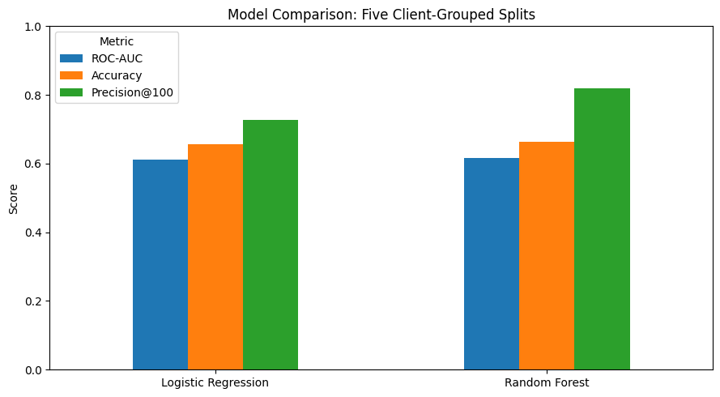
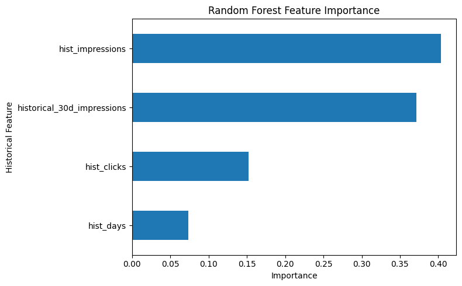

# Machine Learning for Prioritizing Declining Content

**Author:** Faran Khan  
**Program:** FlyRank Machine Learning Internship  
**Year:** 2026

## Abstract

Website content does not always maintain the same level of search visibility over time. Some pages receive fewer impressions than before, making it difficult for analysts to decide which pages need attention first. This study explores whether machine learning can help prioritize website content for human review based on changes in search impressions.

Using anonymized Google Search Console performance data from April, May, and June 2026, the study develops a dataset of 91,033 eligible content items. Historical performance from April and May is used to construct features, while June performance determines whether an item meets the defined declining-impressions label. Logistic Regression and Random Forest are compared using five client-grouped train/test splits.

Random Forest achieved a mean ROC-AUC of 0.6164, compared with 0.6112 for Logistic Regression. It also achieved a mean accuracy of 66.42% and mean Precision@100 of 82.00%, compared with 65.71% and 72.80%, respectively, for Logistic Regression. These results suggest that Random Forest may be useful for creating a preliminary list of content items to investigate. However, the difference in ROC-AUC is small, and the experiment does not establish performance on future months or prove that refreshing content improves search rankings. The findings should therefore be treated as exploratory evidence for a human-review workflow rather than proof of a reliable forecasting system.

## 1. Research Question

Can machine learning rank website content according to its likelihood of meeting a defined declining-impressions label, helping analysts decide which pages to investigate first?

The main objective is to support prioritization. Rather than reviewing every page manually, analysts could use model rankings to identify a smaller group of pages for further investigation.

The model is not intended to make content changes automatically. A decline in impressions can have different explanations, and a model score alone cannot determine what action should be taken or whether that action will improve performance.

## 2. Data and Target Definition

The study uses anonymized daily search-performance records covering April, May, and June 2026. The modeling dataset contains 91,033 eligible content items across 43 clients.

April and May provide the historical information used to construct the model features. June performance is used to define the target variable.

An item is labeled as declining when its June impressions, normalized to a 30-day rate using its observed reporting days, are below 80% of its historical normalized impression rate. Historical eligibility requires at least 100 historical impressions and 40 historical observation days. An item must also have at least 20 observed reporting days in June.

The resulting dataset contains:

| Target label | Number of items | Percentage |
|---|---:|---:|
| Declining | 61,737 | 67.82% |
| Non-declining | 29,296 | 32.18% |
| **Total** | **91,033** | **100.00%** |

The target is imbalanced because approximately two-thirds of the eligible items meet the declining-impressions definition.

An important detail is that the comparison does not necessarily involve two complete, consecutive 30-day periods for every item. Reporting coverage can differ between content items, so the normalized rates should be interpreted with this limitation in mind. The label identifies a measured change in impressions under the study's definition; it does not explain why that change occurred.

## 3. Features and Methodology

### 3.1 Feature Selection

Four historical features were used in the latest experiment:

- `hist_impressions`: Total impressions recorded during the historical period.
- `hist_clicks`: Total clicks recorded during the historical period.
- `hist_days`: Combined number of observed reporting days in April and May.
- `historical_30d_impressions`: Historical impressions normalized to a 30-day rate using the available historical observation days.

These features summarize historical search performance and the amount of reporting coverage available for each item. Client identifiers are used to separate training and test groups, not as model input features.

The historical impression total and normalized impression rate are closely related. Consequently, the model may rely on overlapping information when using both features. This should be considered when interpreting feature importance.

### 3.2 Models

Two classification models were evaluated.

**Logistic Regression** was used as a baseline. The features were standardized before model fitting, and the model was configured with `max_iter=1000` and `random_state=42`.

**Random Forest** was used to test whether a tree-based model could provide better ranking performance. It was configured with 200 trees, `min_samples_leaf=10`, and `random_state=42`.

Both models used the same feature set and were evaluated on the same client-grouped splits.

### 3.3 Validation Strategy

The experiment used five `GroupShuffleSplit` train/test splits, with `test_size=0.25` and `random_state=123`. Each split held out 11 clients, and no client appeared in both the training and test groups within that split.

This approach evaluates whether the models can distinguish declining from non-declining content for clients excluded from the corresponding training split. The test sets differ in size because clients contribute different numbers of content items.

The five splits are repeated evaluations, not five fully independent experiments. Test groups may overlap between different splits, so the reported mean metrics summarize the repeated evaluations rather than five independent samples.

### 3.4 Evaluation Metrics

Three metrics were reported in the latest comparison:

- **ROC-AUC:** Measures how well a model ranks positive examples above negative examples across classification thresholds.
- **Accuracy:** Measures the proportion of test items classified correctly at the selected threshold of 0.5.
- **Precision@100:** Measures the proportion of items carrying the declining label among the 100 highest-ranked items in a test split, or among all available test items if fewer than 100 are available.

Precision@100 is particularly relevant to this study because the intended use is to help analysts decide which items to investigate first. It does not mean that the model has identified pages whose future performance is guaranteed to decline.

## 4. Results

### 4.1 Model Comparison

The table below reports the mean results across the five client-grouped splits.

| Metric | Logistic Regression | Random Forest |
|---|---:|---:|
| Mean ROC-AUC | 0.6112 | 0.6164 |
| Mean accuracy | 65.71% | 66.42% |
| Mean Precision@100 | 72.80% | 82.00% |

Random Forest performed slightly better than Logistic Regression on all three reported metrics. The difference in mean ROC-AUC was only 0.0052, indicating that the models had similar overall ranking discrimination in these evaluations.

The larger difference appeared in Precision@100. Random Forest achieved 82.00%, compared with 72.80% for Logistic Regression. In practical terms, this means that a higher proportion of the highest-ranked items met the study's declining-impressions definition under the Random Forest evaluations.

This result suggests potential value for prioritizing a limited review queue. Nevertheless, it should not be interpreted as evidence that the model will achieve the same precision on future data. The evaluation covers a specific set of clients and a particular three-month period.

### 4.2 Model Comparison Chart

The model comparison chart presents mean ROC-AUC, accuracy, and Precision@100 for the two models. It highlights the small difference in overall discrimination and the larger difference in the top-100 ranking metric.

These metrics measure different aspects of performance. ROC-AUC evaluates ranking discrimination across thresholds, while accuracy evaluates predictions at a particular threshold. Precision@100 focuses on the items that would be reviewed first. For the intended prioritization task, all three provide useful but distinct information.

### 4.3 Random Forest Feature Importance

A Random Forest model was fitted on the full modeling dataset to examine how it used the four historical features. Its feature-importance values were:

| Feature | Importance |
|---|---:|
| `hist_impressions` | 40.32% |
| `historical_30d_impressions` | 37.11% |
| `hist_clicks` | 15.20% |
| `hist_days` | 7.37% |

Historical impressions received the highest importance, followed closely by historical 30-day impressions. Together, these features account for 77.43% of the fitted model's total feature importance.

This pattern suggests that historical impression information played a substantial role in the model's decisions. However, feature importance does not establish causation. It also does not show that one feature independently contributes the same amount of useful information as another, particularly when features are closely related.

These values describe a model fitted on the full dataset. They are not averages across the five validation splits, and their relative importance may change with different samples or model settings.

### 4.4 Target Distribution

The target distribution consists of 61,737 declining items (67.82%) and 29,296 non-declining items (32.18%).

The majority class matters when interpreting model accuracy. A useful evaluation should consider whether the model ranks the relevant items effectively, rather than relying on accuracy alone. This is one reason ROC-AUC and Precision@100 are included alongside accuracy.

The target distribution also reflects the particular threshold and eligibility rules used in this experiment. A different decline threshold or reporting-coverage requirement could produce a different balance between the two classes.

### 4.5 Variation Across Evaluation Splits

The five validation splits produced different results:

| Split | Test-set rows | Held-out clients | Test decline rate |
|---:|---:|---:|---:|
| 1 | 38,888 | 11 | 72.25% |
| 2 | 14,684 | 11 | 54.78% |
| 3 | 28,990 | 11 | 63.77% |
| 4 | 32,782 | 11 | 68.10% |
| 5 | 27,292 | 11 | 67.95% |

The test-set sizes and decline rates vary because the held-out client groups have different numbers of items and different target distributions. The configured test fraction applies to the group-splitting procedure; it does not guarantee that every test set contains exactly 25% of all content rows.

The variation in target rates also helps explain why model performance should be assessed across several splits rather than relying on a single result. Although the mean scores favor Random Forest, the small difference in mean ROC-AUC does not establish that it is consistently superior in all settings.

The evaluation tests generalization to held-out clients within the available dataset. It does not establish how well the models will perform on future months, and additional time-based validation is needed before operational use.

## 5. Limitations

Several limitations affect how the results should be interpreted.

1. **Modest discrimination:** Random Forest achieved a mean ROC-AUC of 0.6164. This indicates some ranking ability, but the separation between declining and non-declining items remains limited.

2. **Small ROC-AUC difference:** The difference between Random Forest and Logistic Regression was only 0.0052. Although Random Forest had higher mean ROC-AUC, the available results do not establish that this difference is statistically significant or that it will persist on new data.

3. **Uneven reporting coverage:** Items were required to have at least 20 observed days in June, while historical impressions were normalized using the available reporting days. This does not guarantee complete or directly comparable observation windows.

4. **Related features:** Historical impressions and historical 30-day impressions contain overlapping information. Their feature-importance values should not be treated as independent contributions or causal effects.

5. **Limited validation period:** The experiment uses April–June 2026 data and five client-grouped splits. It does not independently test performance on later months or establish that the models will generalize to every client.

6. **Variation in client composition:** The held-out groups differ in size and target distribution. As a result, the test-set composition and measured performance vary across splits.

7. **No causal evidence:** The model predicts a defined label from historical measurements. It does not identify the reason for an impression decline and cannot establish whether refreshing a page will improve its search performance.

8. **Exploratory status:** The experiment supports investigating machine learning for content prioritization, but it does not establish that the model is ready for production use. Additional validation, monitoring, and practical evaluation are needed.

## 6. Recommendations

The results suggest a cautious, human-led workflow for using model rankings.

1. **Start with a limited review queue.** Use Random Forest scores to identify a preliminary group of content items for investigation. Treat the ranking as a starting point rather than a final decision.

2. **Check the underlying data.** Review historical impressions, clicks, reporting coverage, and the observed June performance before deciding whether an item requires attention.

3. **Investigate possible explanations.** Analysts should examine search intent, content quality, freshness, competition, and technical issues where relevant. The model itself does not identify which explanation is correct.

4. **Keep a record of decisions.** Document which pages were reviewed, what issues were identified, what changes were made, and what happened afterward. This can help evaluate whether the workflow is useful in practice.

5. **Validate on later periods.** Test the approach on subsequent months that were not used to define the existing target. A time-based evaluation would provide more direct evidence about performance on future content changes.

6. **Evaluate the review process.** Monitor how often high-ranked items reveal actionable issues, as well as precision and the amount of analyst time required. A model is useful only if its rankings support a practical decision process.

7. **Review the target definition.** Compare the current normalized-rate approach with alternative definitions and more complete observation windows. This may help determine whether the label captures meaningful changes rather than differences in reporting coverage.

8. **Reassess the models as more data becomes available.** Compare additional baselines and evaluate stability across clients and time periods before deciding whether the approach is suitable for regular operational use.

**Recommended workflow:**

Model ranking → Human review → Content decision → Refresh or test → Monitor performance

The model should help analysts decide where to investigate first. It should not automatically trigger content changes or be treated as evidence that a particular intervention will improve rankings.

## 7. Conclusion

This study explored whether machine learning could help prioritize website content that meets a defined declining-impressions label. Using anonymized Google Search Console data from April through June 2026, the experiment compared Logistic Regression and Random Forest across five client-grouped train/test splits.

Random Forest achieved a mean ROC-AUC of 0.6164, mean accuracy of 66.42%, and mean Precision@100 of 82.00%. Logistic Regression achieved corresponding values of 0.6112, 65.71%, and 72.80%. The results show a small difference in overall ranking discrimination and a larger difference in the proportion of labeled declining items among the highest-ranked items.

These findings suggest that Random Forest may be worth investigating as a tool for creating a preliminary content-review queue. However, the model's discrimination remains modest, results vary with the held-out clients, and the experiment does not establish performance on future periods.

The main contribution of this work is an exploratory evaluation of a machine-learning-based prioritization workflow. Further temporal validation and practical testing are necessary before relying on the approach operationally. Most importantly, identifying content that meets the declining-impressions label is not the same as explaining why it declined or proving that a content refresh will improve search performance.

## Reproducibility and Privacy

The experiment uses anonymized data and does not require publishing client names, domains, page URLs, or private search queries. Public reporting should continue to avoid exposing identifying information from the underlying warehouse.

Reproducibility depends on retaining the notebook, target definition, feature definitions, model settings, split configuration, and evaluation metrics. The results in this paper correspond to the latest reported experiment using four historical features and five client-grouped splits.

The study is exploratory and intended for research and educational purposes. Its findings should be interpreted within the stated data, validation, and measurement limitations.
