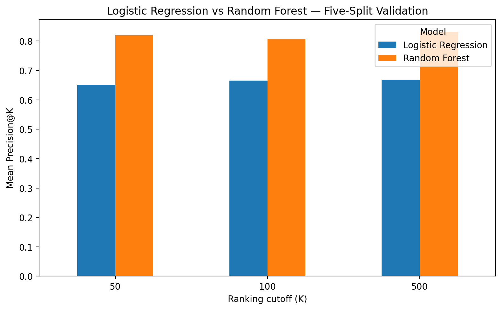
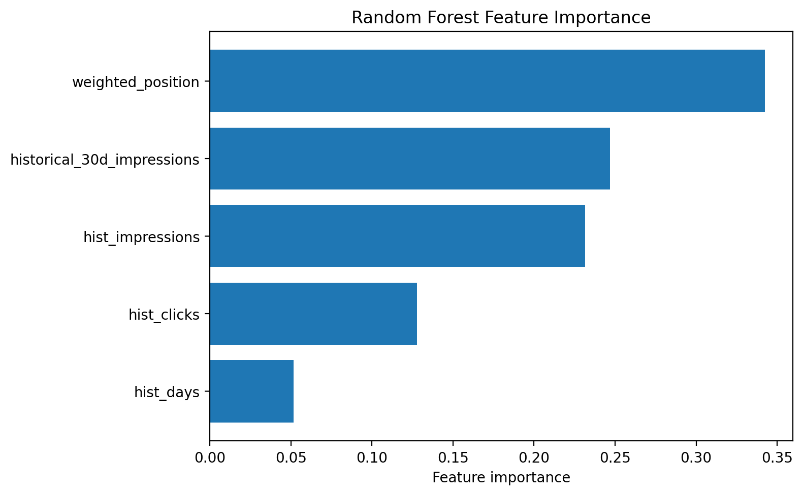
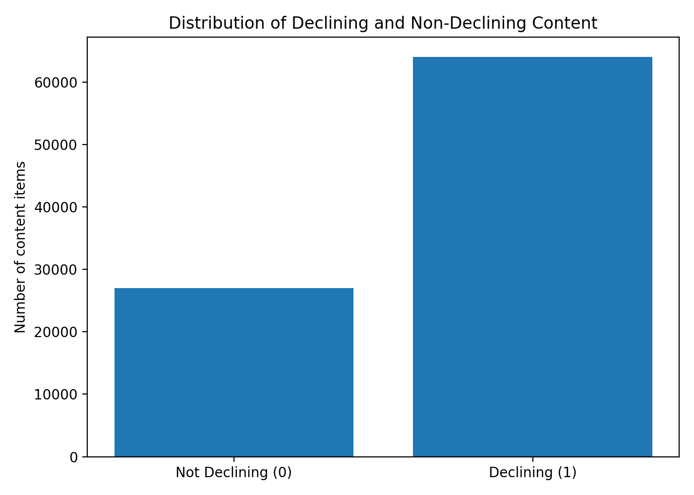

# Machine Learning for Prioritizing Declining Content

**Author:** Faran Khan  
**Program:** FlyRank Machine Learning Internship  
**Year:** 2026

## Abstract

This study investigates whether machine learning can help prioritize website content for human review when search impressions decline. Using anonymized Google Search Console performance data from April, May, and June 2026, the study compares Logistic Regression and Random Forest using five client-grouped train/test splits. Random Forest achieved a mean ROC-AUC of 0.6158, compared with 0.5357 for Logistic Regression. Its mean Precision@500 was 83.16%, compared with 66.92% for Logistic Regression. These preliminary results suggest that Random Forest may help rank potentially declining content for review. However, performance varied across splits, and the experiment does not establish causation or prove that refreshing content improves search performance.

## 1. Research Question

Can machine learning rank website content by its likelihood of meeting a defined declining-impressions label, helping analysts decide which pages to investigate first?

The objective is prioritization for human review, not automatic content changes or guaranteed search-performance improvement.

## 2. Data and Target Definition

The modeling dataset contains 91,033 content items from anonymized daily search-performance records covering April, May, and June 2026. Historical features were derived from April and May, while June performance was used to define the outcome.

An item was labeled as declining when its June impressions fell below 80% of its historical average daily impressions normalized to a 30-day rate, provided that it had at least 20 observed days in June. Historical eligibility required at least 100 historical impressions and 40 historical observation days.

The dataset contains:

- **64,003 declining items (70.31%)**
- **27,030 non-declining items (29.69%)**

This definition does not compare two necessarily complete consecutive 30-day windows. June observation coverage may vary between items.

## 3. Features and Methodology

Five features were used:

- `hist_impressions`
- `hist_days`
- `historical_30d_impressions`
- `hist_clicks`
- `weighted_position`

The weighted-position feature is an approximate proxy and may not exactly match Google's reported average position. Client identifiers were used for grouping, not as model features.

Two models were compared:

- **Logistic Regression:** A standardized baseline model.
- **Random Forest:** 200 trees, `min_samples_leaf=10`, and `random_state=42`.

Both models were evaluated on the same five `GroupShuffleSplit` client-grouped splits using `test_size=0.25` and `random_state=123`. Each split held out 11 clients, with no client overlap between training and test sets.

Metrics included ROC-AUC, accuracy, and Precision@K for K = 50, 100, and 500. Precision@K measures the proportion of labeled declining items among the highest-ranked K items.

## 4. Results

### 4.1 Model Comparison

| Metric | Logistic Regression | Random Forest |
|---|---:|---:|
| Mean ROC-AUC | 0.5357 | 0.6158 |
| Mean Precision@50 | 65.20% | 82.00% |
| Mean Precision@100 | 66.60% | 80.60% |
| Mean Precision@500 | 66.92% | 83.16% |
| Mean accuracy | 68.04% | 67.81% |

Random Forest achieved higher mean ROC-AUC and Precision@K at all three K values. Accuracy was similar between the models, illustrating why accuracy alone may not reflect performance on a prioritization task.

### 4.2 Precision@K Comparison

The chart compares mean Precision@50, Precision@100, and Precision@500 across the five client-grouped splits.

Random Forest achieved mean Precision@500 of 83.16%, compared with 66.92% for Logistic Regression. This indicates that, in these experiments, a greater proportion of the top 500 items ranked by Random Forest met the defined declining-impressions label. The result should not be interpreted as proof of future performance on unseen periods.

### 4.3 Random Forest Feature Importance

Feature importance indicates how the fitted model used its input features. It does not establish that any feature causes content decline. Importance values may also vary across training splits and should be interpreted as model-specific rather than universal relationships.

### 4.4 Target Distribution

The target is imbalanced, with approximately 70.31% of items labeled as declining and 29.69% labeled as non-declining. Because the positive class is the majority, accuracy should be interpreted alongside ranking metrics and the target distribution.

### 4.5 Evaluation Summary

| Split | Test-set rows | Held-out clients | Test decline rate |
|---:|---:|---:|---:|
| 1 | 38,888 | 11 | 74.65% |
| 2 | 14,684 | 11 | 56.82% |
| 3 | 28,990 | 11 | 67.42% |
| 4 | 32,782 | 11 | 70.33% |
| 5 | 27,292 | 11 | 71.32% |

Test-set sizes and decline rates varied across splits because client groups differ in size and content composition. The 25% test setting applies to the client groups selected by the splitter; it does not guarantee that exactly 25% of content rows appear in every test set.

The validation approach tests generalization to held-out client groups within the available data. It does not by itself establish generalization to future months.

## 5. Limitations

1. **Modest discrimination:** Random Forest's mean ROC-AUC was 0.6158, indicating limited separation between declining and non-declining items.
2. **Variation across clients:** ROC-AUC ranged from 0.5416 to 0.6609, and Precision@500 ranged from 66.20% to 93.00%.
3. **Uneven observation periods:** June records required at least 20 observed days, while historical impressions were normalized to a 30-day rate.
4. **Approximate feature measurement:** Weighted position may not exactly match Google's average-position metric.
5. **Limited validation:** Five client-grouped splits do not establish performance on future periods or every client.
6. **Potential temporal measurement concerns:** The target compares June performance against a historical normalized rate. Additional temporal validation is needed to determine how reliably the approach works across complete, later observation periods.
7. **No causal evidence:** The model cannot establish why content declined or whether a content refresh will improve performance.
8. **Experimental status:** The model should be treated as decision support for human review, not a production-ready forecasting system.

## 6. Recommendations

1. Use Random Forest rankings to create a preliminary queue of pages for human review.
2. Investigate impressions, clicks, observation coverage, and search-position estimates for high-priority pages.
3. Review search intent, content quality, freshness, competition, and technical issues before deciding what to change.
4. Record changes and use controlled tests where practical.
5. Evaluate future time periods and additional clients before relying on the model operationally.
6. Monitor precision and the number of useful findings identified by the review process.
7. Reassess the target definition and feature quality as more complete temporal data becomes available.

**Recommended workflow:** Model ranking → Human review → Content decision → Refresh or test → Monitor performance.

The model should help analysts decide where to investigate first. It should not automatically trigger content changes or be treated as evidence that any particular intervention will improve rankings.

## 7. Conclusion

Across five client-grouped splits, Random Forest outperformed Logistic Regression on mean ROC-AUC and Precision@K, while mean accuracy was similar. The results suggest potential value in ranking content for investigation, but the model's discrimination remains modest and performance varies between clients.

The work is an exploratory prioritization study. Further temporal validation and practical testing are required before making operational or causal claims.

## Reproducibility and Privacy

The experiments use anonymized labels and do not require publication of client names, domains, URLs, or private search queries. The reported metrics should be interpreted alongside the validation design and limitations described above.

The reported results were obtained using the five client-grouped evaluation splits described in this paper. The model settings, feature definitions, target definition, and evaluation metrics should be retained with the notebook to support reproducibility.
